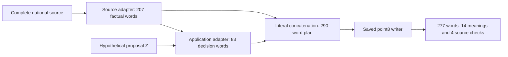

# A complete familiar-case pipeline works; current-state transfer still fails

We now have one complete working prototype: **actual model-generated factual points + actual model-generated application decisions + the saved writer** produce a 277-word response preserving **all 14 required meanings and four source checks**, in the original three-section format. No intermediate model output is hand-rewritten. The source and application replies are fitting outputs, so this establishes composition on a familiar case, not general country-persona quality.

One further probe changes the proposal while keeping the facts fixed. The application adapter repeats an already repaired defect and scores 4/6. **Do not scale country/topic volume yet.** The next training contrast should make the answer depend on the current proposal state rather than memorize one rejection list.

## What made the working piece

All stages use the pinned Qwen3.5-4B base/runtime. The source and application adapters are separate fresh fits; writer weights remain fixed. The first source and application requests are exactly their fitting inputs. Both replies reproduce audited targets. The writer gets their literal concatenation and the unchanged source metadata, hypothetical Z and full writer contract. Its matching base gets the identical input.

| Full fourteen-unit writer endpoint | Content | Source guards | Words | Full pass |
|---|---:|---:|---:|---|
| Base, actual 290-word plan | 7 met + 1 uncertain/14 | 4/4 | 222 | No |
| Saved point8, identical plan | **14/14** | **4/4** | **277** | **Yes** |

The saved writer nearly literally flattens the bullets into three paragraphs. It preserves names, dates, source restrictions, the actual French support pledge, conditional response to possible Iranian transfers, current-note repairs, two operations, a practical cost and absence of official endorsement/future-vote authority. This is the given-content realization behavior the user proposed. Its supplied plan now comes from actual model outputs rather than a hand-written final plan.

## Inspected changes before composition

The target audit finds underspecified status in older shorthand: Libya's duty to investigate/prosecute omitted **must**; cooperation and visa/document requests were noun lists. The new targets preserve exact critical modal phrases, clarify the national speaker/date and distinguish requirements, forecasts and ongoing commitments. Original targets and uncalled drafts remain preserved. Content clarity, quotes, metadata and length change together; this is a supervision repair, not an isolated quote-format causal ablation.

One fresh two-source **64-update** fit, 32 presentations each, reproduces the new 207/210-word targets. It repairs the exposed French monitor's known request-to-completion errors, but neither outside summary passes. A separate dated UK national speech is frozen before calls; it is a different source/event/country in this branch, still the same diplomatic genre/Gaza issue, with unknown pretraining/corpus exposure.

| Separate source summaries | Base | Earlier one-source/64 | Earlier two-source/64 | Repaired-target/64 |
|---|---|---|---|---|
| France, S/PV.9687 | 3/8; 214 words | Earlier 6/8; 236 | Earlier 2 met + 2 uncertain/8; 195 | 4/8; 255; fused word/actor ambiguity |
| UK, S/PV.9694 | 0/8; 171 | 5/8; 305 | 4/8; 205 | 5 met + 2 uncertain/8; 250 |

Full compounds require all concrete parts; 0/8 does not mean every sentence is false. The UK base preserves many correct positions but invents leaders being met and misassigns zone designation. The repaired adapter adds women/children and cooperation details, yet omits beneficiaries, may overstate concern as condemnation, and leaves operational wording uncertain. It supplies no actual modal quotations in either outside summary. The French fused `recommitstolebanonesecurity` fails ordinary word separation; its whitespace count is not a valid compression win. Historical criteria and grades remain intact.

After inspecting all four outputs, the new source adapter runs the unchanged familiar raw-source-plus-Z task. It reaches **8 met + 2 uncertain/14 at 471 words**, against the earlier actual base 1/14. It still falsely lists “no forced borders” as retained in Z, though Z accepts force, and omits/obscures source details. No complete raw-planner pass; its 280-word contract remains unchanged.

Separating application planning receives the unedited actual 207-word source reply. Base's first 70-word request yields 50 words, 3 met + 1 uncertain/6, with an unsupported “until withdrawal” endpoint. Six explicit questions and a 90-word intermediate budget yield 75 words, 3 met + 1 uncertain/6, now incorrectly conditioning support **if Russia withdraws**. The budget/instruction change is a diagnostic; the eventual writer's original fourteen-unit/300-word evaluation is not relaxed. A CPU preparation attempt used the wrong environment and failed before calls/updates; its partial files are preserved.

We therefore teach the application component directly. **One audited 83-word complete application target, fresh 32 updates**, learns the missing behavior: preserve the valid clauses, reject all remaining defects, give scoped operations/cost, retain the actual support duration and answer authority. The fitted reply passes all six application units and four guards. On separate Libya application it scores **4 met + 1 uncertain/6 at 114 words**, versus base 2/6 at 64. The invented support-until-budget/office endpoint and wrong UNMIL name disappear, but current-state omissions, financial wording ambiguity and length survive. Both factual prefixes were already fitted by the source adapter; the Libya application is outside this application fit, not sealed OOD.

The source and application replies then compose the complete endpoint above. No human edits repair a model reply before the writer. No further writer fitting occurs.

## Test whether the application uses the current state

The final untrained note Z-R repairs the transfer-status and blanket-aid-suspension defects, retaining the false package-adoption and forced-border claims. Its factual prefix and original six criteria are byte-identical. The fitted application adapter emits 80 words, **4/6**, still instructing “Remove blanket aid suspension.” It preserves France's support/conditional response but repeats a removed defect and gives an unrelated withdrawal-monitoring direction. We do not compose a successful endpoint from this failed block. This is an adaptive familiar-source/untrained-note probe, not independent confirmation.

## Primary data, hand reading and reproducibility

New UK source: [S/PV.9694, 26 July 2024](https://digitallibrary.un.org/record/4059975?ln=en), official English PDF acquired through the UN symbol API; 25 pages, 625,914 bytes. The cover and pages 16–17 were viewed, all 24 body-page whole/split word inventories match. Woodward's full national span is 69764–72617, excluding the preceding US statement and following Sangjin Kim/Korea statement. Russia chairs; the UK speaker is not a UNRWA official. Statements remain attributed to the bounded national source, not independently adjudicated world facts. The PDF hash and original URLs are in the raw download/source-proof receipts.

The root assistant hand-reads four full national speeches, every new input/question/criterion/current note, all preferred/negative targets and **all 20 complete stored model outputs**. All twenty are uncapped. Target metadata and unclear “ballistics” wording were corrected in an uncalled draft before the application baseline; originals remain preserved. No independent teacher or reviewer is involved.

Native masks/logit gradients, fresh zero-effect initialization, frozen reference, actual presentations, finite parameter updates and exact saved-state reload pass. Only chosen-token NLL is optimized; paired actual negatives/reference forwards have no preference gradient. The source fit takes **99.12 seconds / 15.12 GiB**, application fit **25.35 seconds / 11.85 GiB**, on **NVIDIA RTX PRO 6000 Blackwell Server Edition**. This checkpoint adds **96 actual updates**, cumulative Qwen3.5 **2,910**, separate Qwen2.5 reproduction **582**. All twelve positively identified project GPU processes exited; unfamiliar processes were untouched. Ownership records include host, GPU UUID, PID/start identity, command and run directory.

Evidence: `reports/source-status-composition-combined-20261007-v1.json`; portable replay: `scripts/verify_source_status_composition_combined.py`. Inputs and actual-source provenance are under `data/prepared/source-status-*`, `minimal-application-*`, `actual-composed-writer-*` and `application-current-state-*`; raw source under `data/raw/source-status-grounding-20261007-v1`; complete outputs/grades/weights in their corresponding `runs/aurora-*` directories. Replay validates bytes, execution and stored annotation arithmetic, not independent semantics.

## Next decision

Retain the working familiar-case pipeline and unchanged source/writer weights. Before adding country/topic volume, add application examples that keep the same documented positions while changing which proposal clauses are repaired. Preserve the original 83-word target; freeze another untrained state before fitting; test both application units and full fourteen-unit endpoints. No next fit, queue or sweep is prepared. Independent semantic review, strong OOD, native policy prediction, persona improvement and autonomous multi-agent gains remain unproved. Preserve every earlier branch, criterion, grade, source and Germany/China release.
